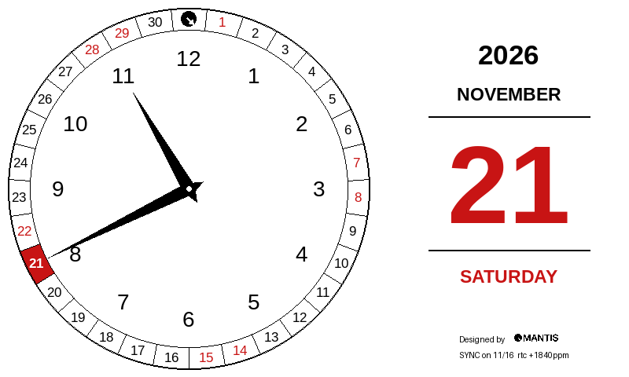

# MANTIS 월침·일침 e-Paper 캘린더

ESP32-C3 SuperMini + Waveshare 7.5" e-Paper HAT (B) 로 만든 저전력 아날로그 캘린더입니다.
시계의 **시침 → 월침**, **분침 → 일침** 으로 바꿔 날짜를 보여 주고, 하루 한 번만 깨어나 18650 배터리 하나로 약 2년 동작을 목표로 합니다.

*A low-power analog-style calendar for ESP32-C3 + 7.5" 3-color e-paper: a month hand and a day hand instead of hour/minute hands.*



| 문서 | 내용 |
|---|---|
| [제작 가이드 PPT](docs/MANTIS_ePaper_Calendar_Guide.pptx) | 스펙 · 부품 · 배선 · 기구 · 소스 구조 흐름도 · 업로드 · 문제 해결 |
| [배선도](docs/images/wiring.png) | SuperMini · e-Paper HAT · 버튼 · 전원부 |
| [오픈소스 고지](THIRD_PARTY_NOTICES.md) | 포함된 라이브러리와 라이선스 |

## 화면 구성

- **하나의 다이얼** (가는 선·일반 굵기 숫자, 바깥 → 안쪽): 일 칸 링(31칸, 칸마다 일 숫자) → 큰 월 숫자(1~12)
  - 31일 칸(12시 위)이 비는 달은 그 칸에 MANTIS 원형 심볼, 그 밖의 없는 날짜(2월 29·30일)는 빈 점
  - 월 숫자는 FreeSans 14.4pt (18pt의 80%, `FreeSans14pt_digits.h`, `tools/make_gfx_font.py`로 생성)
  - **오늘 칸은 반전 표시**: 검정 바탕 + 흰 숫자, 토·일·공휴일이면 빨강 바탕 + 흰 숫자 
- **바늘은 모두 검정**: 월침은 짧고 굵게(월 숫자를 가리킴, 해당 월에 고정), 일침은 월침과 같은 폭으로 길게(일 칸 링 바로 앞까지)
- **빨강 = 토요일·일요일·공휴일** (일 숫자, 큰 날짜, 요일). 시계의 선(테두리·눈금·바늘)은 모두 검정
  - 공휴일 표 `holidays_kr.h`: 2026~2040년, 음력(설·부처님오신날·추석) + 대체공휴일(2023 개정 규칙) 포함
  - 2026-06-03 지방선거일 포함. 이후 선거일·임시공휴일은 `tools/gen_holidays.py`의 `EXTRA`에 넣고 다시 생성
  - 표 범위 밖 연도는 양력 고정 공휴일만 표시
- 이번 달 숫자 반전은 기본 꺼짐 (`config.h`의 `MONTH_INVERT_CURRENT 1`로 켜기)
- 오른쪽 요일 아래에 한 줄로 작게 "Designed by" + MANTIS 로고(56px) (`logo_mantis.h`, 원본 `assets/mantis_logo.png`)
- 오른쪽: 연도 / 월 / 큰 날짜 / 요일 / 공휴일 이름 / Designed by MANTIS / 동기화 상태

## 동작

| 시점 | 동작 |
|---|---|
| 처음 전원 | Wi-Fi + NTP로 시간 확보 → 화면 그림 → 다음 자정까지 deep sleep (실패하면 30분마다 재시도) |
| 매일 00:00:30 | 깨어남 → 날짜 바뀌었으면 화면 갱신(약 20초) → 다음 자정까지 deep sleep |
| 마지막 동기화 후 7일 경과 | 그날 자정 기상 때 NTP 동기화 먼저 (실패하면 다음 날 자정 재시도, 화면 하단에 빨간 표시) |

### RTC 보정 방식
SuperMini에는 32 kHz 크리스털이 없어 deep sleep 중 내부 RC 클럭으로 시간을 셉니다. 이 클럭은 오차가 꽤 커서(수백~수천 ppm, 하루 수십 초~수 분) 단순히 1주일에 한 번 맞추기만 하면 주말쯤엔 자정 갱신이 몇 분씩 어긋날 수 있습니다. 그래서:

1. NTP 동기화 때 "RTC가 센 시간 vs 실제 시간"을 비교해 **오차율(clockRatio)** 을 RTC 메모리에 학습
2. 잘 때 타이머를 `실제 원하는 시간 / clockRatio` 로 설정
3. 깨어나면 시스템 시계에 `(clockRatio − 1) × 잔 시간` 만큼 보정 적용
4. 자정 직전(23:59:xx)에 일찍 깼다면 화면은 그대로 두고 남은 시간만 더 잠

첫 1주일은 학습 전이라 오차가 남고, 두 번째 동기화부터 정확해집니다. 화면 하단에 `rtc +NNNNppm` 으로 학습된 값이 표시됩니다.

## Wi-Fi 설정 (스마트폰 + QR 코드)

키패드 없이 스마트폰으로 설정합니다. 화면 안내는 모두 영어입니다.

1. 처음 켜면(저장된 Wi-Fi 없음) 화면에 **QR 코드와 설정용 Wi-Fi 이름(MANTIS-CAL-xxxx)/비밀번호**가 표시됨
2. 휴대폰 카메라로 QR을 찍으면 설정용 Wi-Fi에 바로 접속 → 설정 페이지가 자동으로 열림 (안 열리면 브라우저에서 `192.168.4.1`)
3. **Configure WiFi** → 집 Wi-Fi 선택, 비밀번호 입력(필요하면 공휴일 API 키도) → **Save**
4. 접속에 성공하면 Flash(NVS)에 저장하고 바로 시간 동기화 후 캘린더 표시

- 설정용 Wi-Fi 이름/비밀번호는 기기 MAC 주소로 만들어서 기기마다 다르고 항상 같음
- **10분** 동안 설정이 없으면 "Setup timed out" 화면을 띄우고 RESET을 누를 때까지 잠듦
- **다시 설정하기**: 사이드 버튼(GPIO5)을 **3초** 누름 (예비: RESET 후 LED가 켜진 3초 안에 BOOT 1초)
- 주간 동기화가 실패하면 캘린더 오른쪽 아래에 빨간 `SYNC FAILED` 와 `Hold button 3 s: Wi-Fi setup` 안내가 표시됨

## 사이드 버튼 (GPIO5)

| 조작 | 동작 |
|---|---|
| 짧게 | deep sleep에서 즉시 깨어나 시간 동기화 + 화면 갱신 |
| 3초 | Wi-Fi 설정 모드 (QR 화면) |

- 배선: `GPIO5 ─ 버튼 ─ GND`, `GPIO5 ─ 1MΩ ─ 3V3` (선택: `GPIO5 ─ 100nF ─ GND`)
- deep sleep 기상은 GPIO0~5만 가능해서 GPIO5 사용 (0·1·3·4는 e-Paper, 2는 부팅 핀)
- 버튼으로 중간에 깨어나도 잠든 시간만큼 RTC 오차 보정을 적용
- `config.h`의 `WIFI_SSID`는 비워 두는 것을 권장 (적어 두면 저장값이 없을 때의 기본값으로 쓰임)

## 서버 공휴일 (선택)

내장 표만으로는 임시공휴일·선거일처럼 몇 주 전에 정해지는 날을 알 수 없어서, 서버에서 받아 보완합니다.

1. [공공데이터포털](https://www.data.go.kr/data/15012690/openapi.do) 회원가입 → "한국천문연구원_특일 정보" 활용신청 (자동승인)
2. 마이페이지에서 **일반 인증키(Encoding)** 복사 → Wi-Fi 설정 페이지의 *Holiday API key* 칸에 입력 (또는 `config.h` 의 `HOLIDAY_API_KEY`)
3. 동작: 매주 NTP 동기화로 Wi-Fi가 켜졌을 때, **달이 바뀌었으면 1회** 올해·내년 공휴일을 받아 Flash(NVS)에 저장
   - 서버 데이터가 있는 연도는 서버 우선, 없으면 내장 표
   - 실패하면 기존 저장값/내장 표 유지, 다음 주 동기화 때 재시도
   - 추가 소요 약 1~2초 (HTTP 2회), 전력 영향 무시할 수준
4. 키를 비워 두면 이 기능은 꺼지고 내장 표만 사용
5. 서버에만 있는 공휴일(임시공휴일)은 화면에 "PUBLIC HOLIDAY"로 표시 (한글 폰트 미사용)

## 배선

| HAT 핀 | SuperMini |
|---|---|
| VCC | 3V3 |
| GND | GND |
| DIN | GPIO6 |
| CLK | GPIO4 |
| CS | GPIO7 |
| DC | GPIO1 |
| RST | GPIO10 |
| BUSY | GPIO3 |
| PWR | GPIO0 (HAT Rev2.2 이상만. 없으면 `PIN_EPD_PWR -1`) |
| (버튼) | GPIO5 ─ 버튼 ─ GND, GPIO5 ─ 1MΩ ─ 3V3 |

전체 배선도(전원부 포함): [docs/images/wiring.png](docs/images/wiring.png)

- HAT 뒷면 **Interface Config 스위치는 0 (4-line SPI)**
- GPIO2/8/9는 부트 스트래핑 핀이라 사용하지 않음

## 빌드

**PlatformIO**: 폴더 열고 `pio run -t upload` (빌드 확인됨: RAM 41%, Flash 40% / 3MB 앱 영역, OTA 없음)

**Arduino IDE**
1. 보드: *ESP32C3 Dev Module*, *USB CDC On Boot: Enabled*
2. 라이브러리 매니저에서 **GxEPD2**, **Adafruit GFX Library**, **ArduinoJson (v7)**, **WiFiManager (tzapu)**, **QRCode (ricmoo)** 설치
3. *Tools → Partition Scheme → Huge APP (3MB No OTA)* 선택 (OTA 미사용)
4. 업로드 (Wi-Fi는 처음 켤 때 스마트폰으로 설정)

패널이 구형 640×384(V1)면 `EPD_PANEL_V2 0`.

> deep sleep 중에는 USB 시리얼이 끊깁니다. 다시 업로드가 안 되면 BOOT(GPIO9) 누른 채 RESET.

## 저전력 팁 (배터리 수명을 좌우)

전력의 대부분은 **잠자는 동안의 대기 전류**입니다. 하루 한 번 화면 갱신(~20초)과 주 1회 Wi-Fi(~5초)는 상대적으로 작습니다.

1. **SuperMini의 빨간 전원 LED 제거** — 이것만으로 수 mA. 가장 큰 효과
2. 보드 LDO의 대기 전류 확인 (제품마다 다름). 배터리 직결이라면 저 Iq LDO(예: HT7333, ME6211) 사용
3. HAT Rev2.2+는 PWR 핀으로 패널 전원 차단 (코드에 반영). 구형 HAT는 P-MOSFET으로 VCC 차단 권장
4. 운영 시 `DEBUG_SERIAL 0`
5. 3색 패널은 저온(0℃ 이하)에서 갱신 불량이 생길 수 있음

## 폴더 구성

```
EpaperMonthDayClock/   펌웨어 (Arduino 스케치 폴더)
  EpaperMonthDayClock.ino   메인: 기상·RTC 보정·NTP·화면·버튼·절전
  config.h                  사용자 설정 (핀, 주기, 옵션)
  wifi_config.h             Wi-Fi·API 키 NVS 저장, 설정용 AP
  holiday_server.h          공휴일 API (월 1회) → NVS
  holidays_kr.h             내장 공휴일 표 2026~2040 (자동 생성)
  logo_mantis.h             로고 비트맵
  FreeSans14pt_digits.h     월 숫자 글꼴 (자동 생성)
tools/                 PC용 스크립트
  gen_holidays.py           공휴일 표 생성 (pip install korean-lunar-calendar)
  make_gfx_font.py          GFX 글꼴 생성 (pip install freetype-py)
  preview.py, preview_setup.py   화면 미리보기 (Pillow, qrcode)
  make_diagrams.py, make_deck.js 도면 / 제작 가이드 PPT 생성
assets/                로고 원본·변환본
docs/                  제작 가이드 PPT, docs/images/ 미리보기·도면
licenses/              LGPL-2.1, Apache-2.0 전문
```

미리보기 이미지는 PC 글꼴로 그린 근사치라 실제 패널과 글자 모양이 조금 다릅니다.

## 라이선스

- 펌웨어와 도구: **GPL-3.0-or-later** ([LICENSE](LICENSE)). e-Paper 드라이버 GxEPD2가 GPL-3.0이므로 전체를 GPL-3.0으로 배포합니다.
- 포함된 오픈소스와 저작권 고지: [THIRD_PARTY_NOTICES.md](THIRD_PARTY_NOTICES.md), LGPL·Apache 전문은 [licenses/](licenses/)
- 이 기기는 USB-C로 수정한 펌웨어를 설치할 수 있습니다 (Secure Boot·Flash 암호화 미사용).
- NTP 기본 서버: `time.google.com` · `time.cloudflare.com` · `time.windows.com`
- **상표:** "MANTIS" 이름과 로고는 MANTIS의 상표입니다. GPL은 소스 코드 사용 권한을 줄 뿐 상표 사용권을 주지 않습니다. 수정판을 배포할 때는 로고(`logo_mantis.h`, `assets/`)를 바꿔 주세요.
